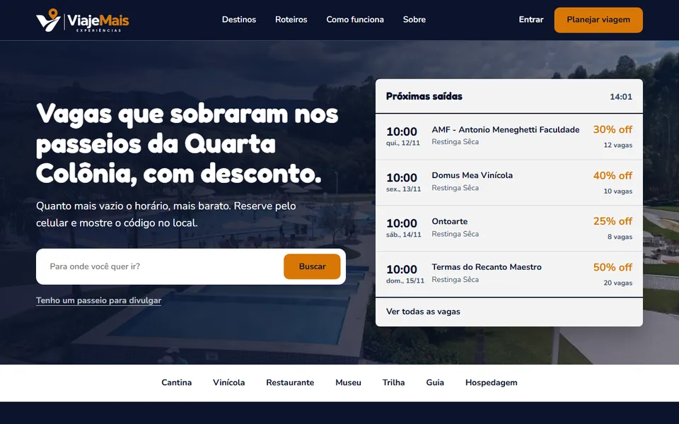

# Viaje Mais

PWA de turismo para a **Quarta Colônia (RS)**. Mostra as vagas que sobraram em passeios, museus, vinícolas e trilhas, com desconto: quanto mais vazio o horário, maior o desconto. O turista reserva pelo celular e recebe um código para usar no local, mesmo sem internet.

Projeto campeão do **Ideathon 2026** da Antonio Meneghetti Faculdade (out/2026). Próxima etapa: StartCUP.



## Onde está cada coisa

| Pasta | O que tem |
|---|---|
| [`frontend/`](frontend/) | O que aparece na tela: páginas, estilos e o JavaScript que roda no navegador |
| [`backend/`](backend/) | O servidor: regras de negócio, login e a API (`/api/...`) |
| [`banco-de-dados/`](banco-de-dados/) | Onde os dados ficam (o arquivo `db.json`, que não vai para o GitHub) e a estrutura deles |

Cada pasta tem o seu README explicando o que é cada arquivo. Na raiz ficam só o `server.js`, que liga o backend, e o atalho `INICIAR.bat`.

## O problema e a ideia

Passeios saem com vagas sobrando: o dono gasta o mesmo e ganha menos. Ao mesmo tempo, muitos turistas deixam de passear por achar caro. O Viaje Mais junta os dois lados, inspirado no app Primeira Mesa (descontos em restaurantes nos horários vazios), e reúne em um só lugar as atrações das nove cidades da região: Agudo, Dona Francisca, Faxinal do Soturno, Ivorá, Nova Palma, Pinhal Grande, Restinga Sêca, São João do Polêsine e Silveira Martins.

## Como o projeto foi feito

O Viaje Mais nasceu no Ideathon 2026 como projeto em equipe e segue para o StartCUP com esta equipe: Henry Azambuja Godoi (Desenvolvedor Principal), Enzo Massao, Samuel Fritz, Richard Matge e Professora Vônia Engel. Eu desenvolvi o protótipo funcional, com auxílio de IA.

O protótipo é um PWA em HTML, CSS e JavaScript, com um back-end próprio em Node.js. O servidor usa só os módulos que já vêm com o Node, sem `npm install`, sem Vite nem Webpack e sem etapa de build: basta ter o Node instalado e rodar `node server.js`. Os dados ficam em um arquivo JSON, o que deixa a demonstração simples de ligar em qualquer computador; para produção, a troca por um banco de dados de verdade está na lista do que falta.

O back-end cuida do login com senha criptografada (scrypt com sal aleatório), das sessões por cookie HttpOnly, do cálculo do desconto dinâmico, das reservas e da validação única dos vouchers. O QR do voucher é assinado pelo servidor, e assim o celular do operador consegue conferir se ele é verdadeiro mesmo sem internet. Por ser PWA, o site pode ser instalado no celular e guarda as telas para abrir offline.

Os painéis do operador e do administrador ficam em um repositório separado, o Dashboard, que não é público.

## Como rodar

Requisito: [Node.js](https://nodejs.org) 18 ou mais novo (usamos o 22 LTS). Não precisa instalar pacotes.

```bash
node server.js
```

Abra http://localhost:3000. No Windows, também dá para dar dois cliques em `INICIAR.bat`.

Para usar outra porta: `PORT=4000 node server.js` (no PowerShell: `$env:PORT=4000; node server.js`).

Na primeira execução o servidor cria o arquivo `banco-de-dados/db.json` com dados de demonstração. Para começar do zero, feche o servidor e apague esse arquivo.

Os painéis do operador e do administrador ficam no repositório do Dashboard, que não é público. Quem tem a pasta dele recebe os painéis do mesmo servidor, em http://localhost:3000/operador/ e http://localhost:3000/admin/. Por padrão ele procura a pasta `Dashboard` ao lado da pasta do site; para usar outra, defina `DASHBOARD_DIR`.

### Contas de teste

| Perfil | E-mail | Senha |
|---|---|---|
| Administrador | `admin@viajemais.com` | sorteada no primeiro uso e mostrada no terminal |
| Operador de turismo | `operador@viajemais.com` | sorteada no primeiro uso e mostrada no terminal |
| Viajante | crie pela tela "Criar conta" | |

Anote as senhas quando o servidor criar o banco: elas não aparecem de novo. Para trocar a senha de qualquer conta, com o servidor desligado: `node backend/trocar-senha.js <e-mail> <nova senha>`.

O operador de teste é o dono do "Parceiro Demo", que já tem passeios aprovados e saídas futuras.

### Roteiro para testar (fluxo do pitch)

1. Entre como **operador** e abra o painel do parceiro (`/operador/`). Publique uma saída: data futura, número de vagas, preço e desconto máximo.
2. Em outra janela anônima, entre como **viajante**: veja a oferta, reserve e receba o voucher.
3. Volte ao operador e valide o código ou o QR do voucher. Usar o mesmo voucher de novo é recusado.
4. Entre como **administrador** (`/admin/`) para ver as reservas, aprovar parceiros e passeios e acompanhar os repasses.

Dois perfis ao mesmo tempo precisam de navegadores ou janelas anônimas separadas: o login vale para todas as abas do mesmo navegador.

## O que já funciona

- **Página inicial** com o quadro "Próximas saídas": as próximas vagas reais aparecem mesmo sem login. A busca e cada saída levam ao login e, depois dele, direto para as ofertas filtradas ou para a oferta escolhida.
- **Desconto dinâmico:** `desconto = descontoMax × vagas livres ÷ vagas`. Faltando 2 horas ou menos, vai ao desconto máximo e aparece o selo "Última hora".
- **Reserva** de 1 a 10 pessoas, com nome e telefone. O preço fica travado no momento da reserva. Se as vagas acabarem durante a reserva, o app avisa.
- **Voucher** em forma de cartão que inclina, com QR code e o código de 8 caracteres embaixo, salvo no aparelho para abrir sem internet.
- **Cancelamento** pelo viajante até 3 horas antes, com as vagas devolvidas à oferta.
- **Validação do voucher** pelo operador no local, uma única vez. O QR é assinado pelo servidor, então o celular do operador confere se ele é verdadeiro mesmo sem internet e sincroniza depois.
- **Perfil do viajante:** foto, nome e telefone, troca de senha, exclusão da conta, histórico de reservas e quanto já economizou com os descontos.
- **Três perfis:**
  - **viajante:** ofertas, reservas, voucher e avaliação;
  - **operador** (painel do parceiro): passeios, saídas, validação, equipe de validadores, avaliações e repasses;
  - **administrador:** aprovações, parceiros, comissão, reservas, repasses e auditoria.
- **Segurança:** senhas com scrypt e sal aleatório, sessão em cookie HttpOnly, validação de tudo no servidor, texto escapado na tela e dados pessoais mascarados nos painéis.
- **PWA:** instalável e com cache offline das telas.

## Estrutura

```
server.js                  ponto de partida: só liga o backend
INICIAR.bat                dois cliques para ligar no Windows
frontend/                  o que o navegador baixa (cada arquivo é um endereço do site)
  index.html               página inicial
  entrar.html              login e cadastro
  painel.html              área logada (viajante, operador, administrador)
  css/                     base.css (cores e fontes), home.css, app.css
  js/                      home.js, entrar.js, painel.js, qrcode.js (gerador de QR, MIT)
  sw.js                    service worker (cache offline)
backend/                   o servidor
  servidor.js              entrega o frontend e os painéis, ou chama a rota da API
  config.js                constantes (porta, categorias, cidades, comissão, 2h de última hora, 3h para cancelar)
  banco.js                 lê e grava banco-de-dados/db.json (e converte o formato antigo)
  modelo.js, migracao.js   formato dos registros e a conversão do banco antigo
  dados-demonstracao.js    contas de teste do primeiro uso
  seguranca.js             senhas e código do voucher
  voucher.js               assinatura do QR do voucher
  sessoes.js               login por cookie
  regras.js                desconto, vagas, cancelamento e repasse
  rotas/                   API: conta.js, perfil.js, ofertas.js (site), operador.js e admin.js (painéis)
banco-de-dados/            db.json (fora do GitHub) e a explicação da estrutura dos dados
```

Sem dependências: o servidor usa só módulos nativos do Node.js e os dados ficam num arquivo JSON. O único código de terceiros é o `frontend/js/qrcode.js`, copiado sem npm. As rotas da API estão nos arquivos de `backend/rotas/`.

## Testar no celular

O PWA só instala em endereço seguro (HTTPS). No computador, `localhost` já funciona. Para abrir no celular, use o [ngrok](https://ngrok.com):

```bash
ngrok http 3000
```

e abra o endereço `https` que ele mostrar.

Depois de atualizar o código, aperte **Ctrl + Shift + R** no navegador para não ficar com a versão antiga guardada no cache.

## Ainda não feito

- Pagamento por Pix (hoje o turista paga no local; o repasse ao parceiro é marcado como pago à mão pelo administrador).
- Envio de e-mails de verdade (hoje os avisos ficam gravados como "simulado").
- Entrar com Google (o botão existe, mas falta configurar o Client ID).
- Páginas por cidade e por roteiro.
- Newsletter, avisos de última hora por notificação ou WhatsApp e pacotes passeio + jantar.
- Para produção: banco de dados de verdade, HTTPS e recuperação de senha.
